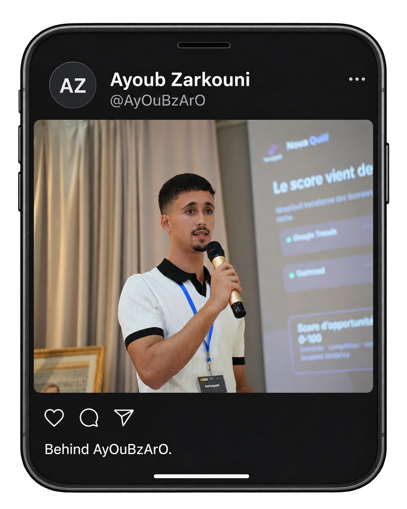

  

  <a href="#selected-work">Projects</a> &nbsp; / &nbsp;
  <a href="#toolkit">Stack</a> &nbsp; / &nbsp;
  <a href="#under-the-hood">Diagrams</a> &nbsp; / &nbsp;
  <a href="#github-in-numbers">Statistics</a> &nbsp; / &nbsp;
  <a href="#lets-talk">Contact</a>

### I'm Ayoub, the developer behind AyOuBzArO.

I'm a full-stack developer from **Morocco**. AyOuBzArO is where I share what I'm building: an ebook platform, a website auditing tool, a car rental website, and a few other projects you'll find below.

I work mostly with **Python, FastAPI and Flask** on the backend, alongside JavaScript and TypeScript on the frontend. I like working across the whole application. The interface matters, but so do the login flow, the database, the payments, and what happens when something goes wrong.

Right now, I'm building **[NovaQuill](https://novaquill.org/)**, which takes a book idea through research, writing and export. It's the kind of project that brings several parts of my work together in one place.

I'm also open to freelance work. If you have something in mind, **[tell me about it](mailto:ayoubzarkouni30@gmail.com)**. We can start with the problem you're trying to solve.

[LinkedIn ↗](https://www.linkedin.com/in/ayoub-zarkouni-2207373b7) &nbsp; · &nbsp; [Fiverr ↗](https://www.fiverr.com/ayoub_zarkouni)

 

## Things I've built

### NovaQuill

<a href="https://novaquill.org/">
<picture>
  <source media="(max-width: 600px)" srcset="assets/designed/novaquill-card-mobile.svg">
  
</picture>
</a>

**The idea:** give someone with a book topic a place to turn it into a structured ebook, without moving between separate research, writing and export tools.

**What I built:** topic analysis, chapter generation, quality review, PDF/DOCX/EPUB exports, accounts and Stripe subscriptions with plan-based limits.

**[Open NovaQuill ↗](https://novaquill.org/)** &nbsp; · &nbsp; [See the workflow ↓](#novaquill-workflow) &nbsp; · &nbsp; Private source

### SiteGuard AI

<a href="https://github.com/AyOuBzArO/siteguard-ai">
<picture>
  <source media="(max-width: 600px)" srcset="assets/designed/siteguard-card-mobile.svg">
  
</picture>
</a>

**The idea:** a website audit should show you what's wrong, where it happened, and what evidence supports the finding.

**What I built:** SEO, accessibility, security and performance checks, scan history, a findings workspace and PDF reports. The AI assistant explains findings; it doesn't invent them or decide their scores.

**[Read the code ↗](https://github.com/AyOuBzArO/siteguard-ai)** &nbsp; · &nbsp; [See the architecture ↓](#inside-siteguard) &nbsp; · &nbsp; Public repository

### Auto Rinta Car

<a href="https://autorintacar.com/">
<picture>
  <source media="(max-width: 600px)" srcset="assets/designed/auto-rinta-card-mobile.svg">
  
</picture>
</a>

**The idea:** make it easy for customers to find a car and contact the agency, while giving staff a practical way to keep the fleet up to date.

**What I built:** vehicle listings, prices, availability, photo galleries and WhatsApp contact, plus a protected administration area. The site supports French and Arabic, including right-to-left layouts.

**[Visit the website ↗](https://autorintacar.com/)** &nbsp; · &nbsp; Business application

<strong>A few more projects</strong> — CSAI Days, DevScope &amp; IMS

 

**[CSAI Days 2026](https://csaidays.medi-asd.org/hackathon.html)** — Frontend implementation for a technology event: four languages, Arabic RTL and application flows. Deployment by collaborator Issam. [Code ↗](https://github.com/issama17/csaidays-2026)

**[DevScope](https://github.com/AyOuBzArO/Developer-Portfolio-Analytics-Platform_Devscope)** — GitHub portfolio analysis with transparent heuristics and AI-assisted recommendations. Guidance, not a measure of developer quality.

**[IMS](https://github.com/AyOuBzArO/Inventory-management-system)** — Inventory and sales management with dashboards and a data-aware assistant.

## What I work with

<picture>
  <source media="(max-width: 600px)" srcset="assets/designed/stack-backend-mobile.svg">
  
</picture>

<picture>
  <source media="(max-width: 600px)" srcset="assets/designed/stack-interfaces-mobile.svg">
  
</picture>

<picture>
  <source media="(max-width: 600px)" srcset="assets/designed/stack-delivery-mobile.svg">
  
</picture>

Depending on the project: **SQLAlchemy, MySQL, Prisma, Groq, OpenRouter, GitHub API and pytest**.

## Under the hood

Two examples of how the pieces fit together in my projects.

### NovaQuill · the publishing workflow

<picture>
  <source media="(max-width: 600px)" srcset="assets/designed/novaquill-flow-mobile.svg">
  
</picture>

The writing flow sits inside a SaaS product: accounts, subscriptions and plan limits are part of the application, not separate afterthoughts.

### SiteGuard AI · evidence before explanation

<picture>
  <source media="(max-width: 600px)" srcset="assets/visuals/siteguard-flow-mobile.svg">
  
</picture>

Scan results stay available independently of the AI provider. The assistant receives a selected finding and its context when someone asks for help understanding it.

Read both diagrams as text

- **NovaQuill:** topic → research → chapter generation → quality review → PDF, DOCX or EPUB export. Accounts, subscriptions and plan limits support this workflow.
- **SiteGuard:** public URL validation → bounded crawl → deterministic checks and PageSpeed performance data → stored evidence, findings and scores → analysis workspace and PDF reports. Optional Groq guidance explains a selected finding; it does not detect findings or set scores.

## GitHub in numbers

<picture>
  <source media="(max-width: 600px)" srcset="assets/designed/github-stats-mobile.svg">
  
</picture>

This is a **dated snapshot of public work**, not my whole portfolio. Private projects such as NovaQuill aren't represented in the language chart. The percentages describe code volume, not proficiency.

[View the numbers and sources](assets/data/github-public.md) &nbsp; · &nbsp; [Browse my repositories ↗](https://github.com/AyOuBzArO?tab=repositories)

## Have something in mind?

A new product, a website that needs work, or a process you're tired of doing by hand? Send me a short message about it.

**[Email me ↗](mailto:ayoubzarkouni30@gmail.com)** &nbsp; · &nbsp; [LinkedIn](https://www.linkedin.com/in/ayoub-zarkouni-2207373b7) &nbsp; · &nbsp; [Work with me on Fiverr](https://www.fiverr.com/ayoub_zarkouni)

Ayoub Zarkouni · the developer behind AyOuBzArO · Morocco
