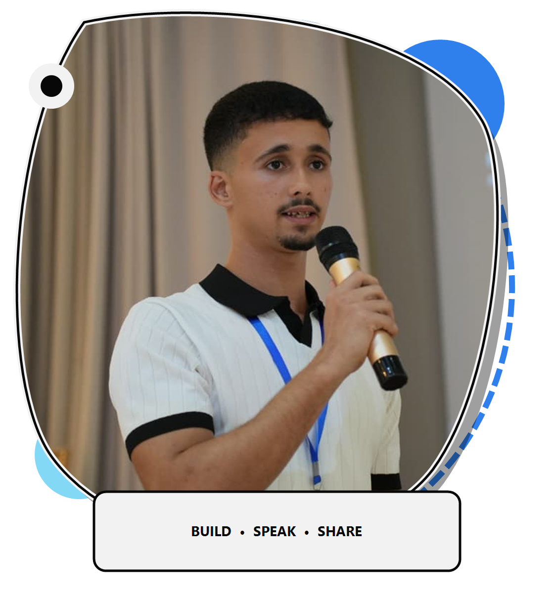
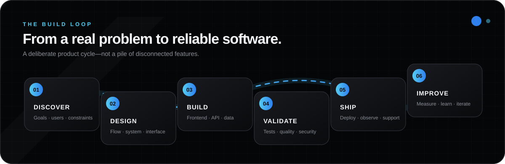
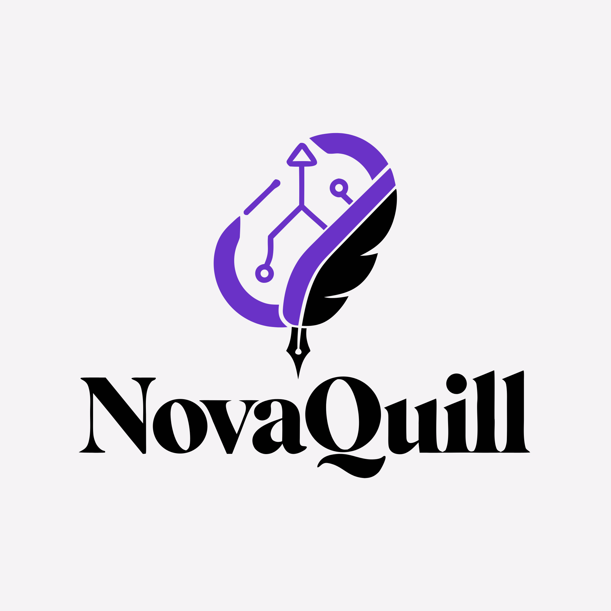
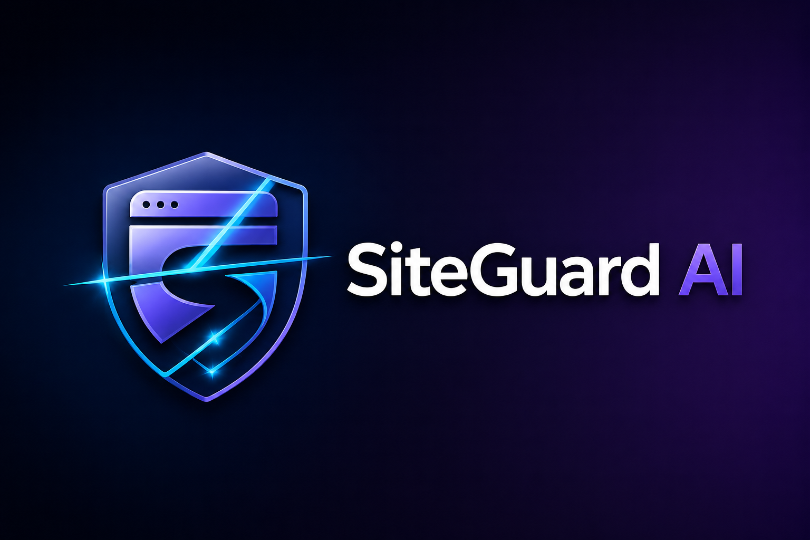
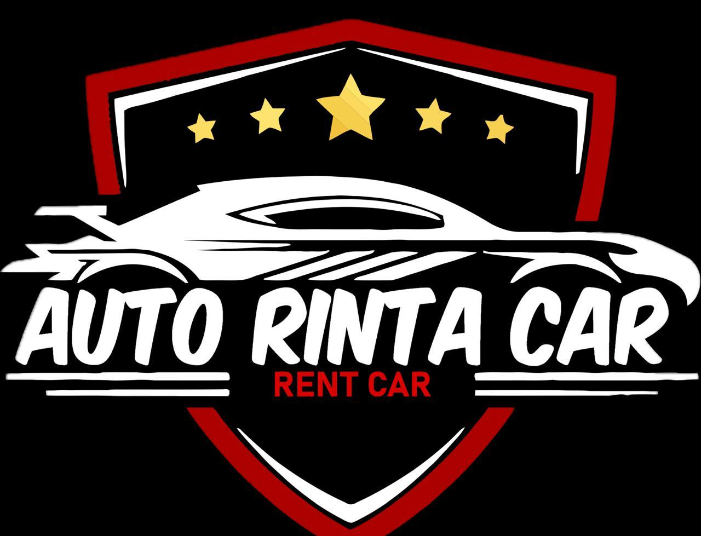
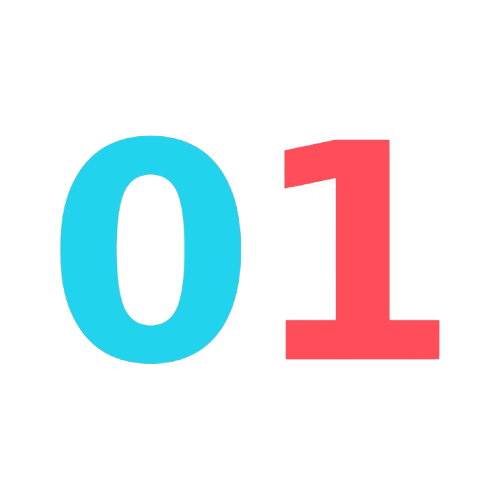
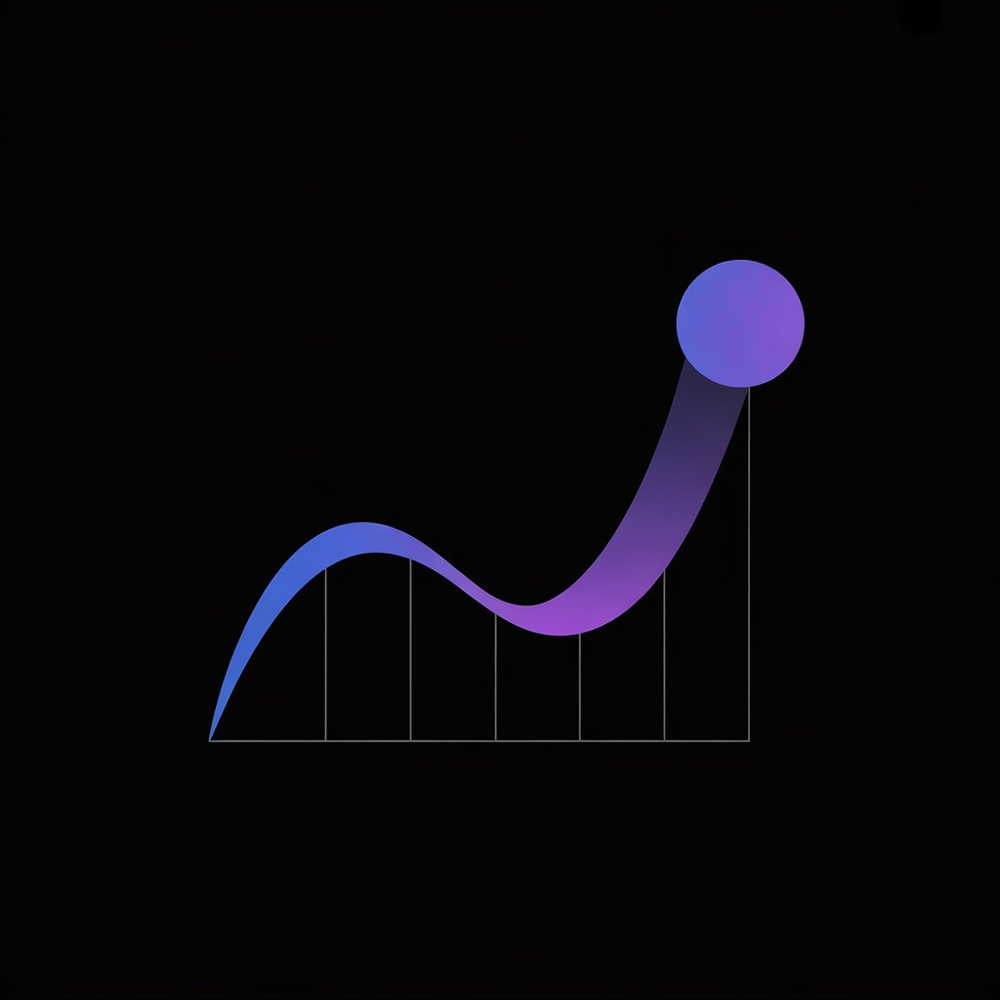
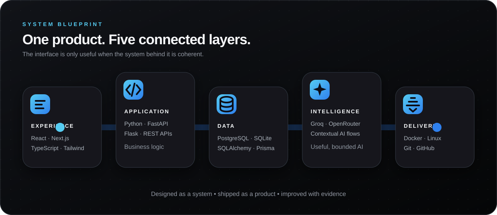

  

 

## Building products that work beyond the demo.

I'm **Ayoub Zarkouni**, a full-stack developer who turns ideas and business requirements into reliable software—from product flows and interfaces to APIs, databases, deployment, and carefully bounded AI features.

I build **SaaS products**, **business systems**, **developer tools**, and **connected web applications** with a focus on clarity, maintainability, and real-world usefulness.

`SaaS` · `Business Software` · `REST APIs` · `AI Integrations` · `Product Engineering`

  
  

  
  

 

---

## How I take a product from idea to release

  

> I care about the whole product: what problem it solves, how the system fits together, how it feels to use, and whether it remains dependable after launch.

## Selected work

<table>
  <tr>
    <td width="33%" valign="top">
      

      <h3 align="center">NovaQuill</h3>
      
<strong>AI Ebook Generation SaaS</strong>

      
Turns a niche into a structured, export-ready ebook through research, plan-aware generation, quality review, subscriptions, sharing, and multi-format exports.

      
<code>FastAPI</code> <code>PostgreSQL</code> <code>Stripe</code> <code>Groq</code>

      

    </td>
    <td width="33%" valign="top">
      

      <h3 align="center">SiteGuard AI</h3>
      
<strong>Website Quality &amp; Audit Platform</strong>

      
Combines deterministic SEO, accessibility, security, TLS, broken-link, and performance checks with contextual remediation guidance.

      
<code>Flask</code> <code>MySQL</code> <code>PageSpeed</code> <code>Groq</code>

      

    </td>
    <td width="33%" valign="top">
      

      <h3 align="center">Auto Rinta Car</h3>
      
<strong>Bilingual Car Rental Platform</strong>

      
Lets customers explore vehicles, prices, availability, galleries, and WhatsApp contact flows while staff manage the fleet from a protected workspace.

      
<code>Flask</code> <code>SQLAlchemy</code> <code>JavaScript</code> <code>RTL</code>

      

    </td>
  </tr>
</table>

  
<strong>More projects — CSAI Days 2026, DevScope, and IMS</strong>

   
  <table>
    <tr>
      <td width="88" align="center"></td>
      <td><strong>CSAI Days 2026</strong> Responsive multilingual event experience with English, French, Spanish, and Arabic RTL support. <a href="https://csaidays.medi-asd.org/hackathon.html">Live site</a> · <a href="https://github.com/issama17/csaidays-2026">Repository</a></td>
    </tr>
    <tr>
      <td width="88" align="center"></td>
      <td><strong>DevScope</strong> GitHub portfolio analyzer using public repository data, transparent scoring, analytics, and AI-assisted recommendations. <a href="https://github.com/AyOuBzArO/Developer-Portfolio-Analytics-Platform_Devscope">Repository</a></td>
    </tr>
    <tr>
      <td width="88" align="center"></td>
      <td><strong>IMS</strong> Inventory and sales application with operational dashboards, interactive charts, and a data-aware assistant. <a href="https://github.com/AyOuBzArO/Inventory-management-system">Repository</a></td>
    </tr>
  </table>

## What I build

<table>
  <tr>
    <td width="50%"><strong>Product applications</strong> SaaS platforms · MVPs · developer tools · customer-facing products</td>
    <td width="50%"><strong>Business software</strong> Admin workspaces · inventory systems · operational dashboards · analytics</td>
  </tr>
  <tr>
    <td width="50%"><strong>Backend systems</strong> Python services · REST APIs · authentication · database workflows</td>
    <td width="50%"><strong>Connected experiences</strong> LLM features · payments · third-party APIs · multilingual interfaces</td>
  </tr>
</table>

## A full-stack system, not isolated screens

  

## Technology stack

  

<table>
  <tr><td><strong>Backend</strong></td><td>Python · FastAPI · Flask · REST APIs · SQLAlchemy</td></tr>
  <tr><td><strong>Frontend</strong></td><td>HTML · CSS · JavaScript · TypeScript · React · Next.js · Tailwind CSS</td></tr>
  <tr><td><strong>Data</strong></td><td>PostgreSQL · MySQL · SQLite · Prisma</td></tr>
  <tr><td><strong>AI &amp; integrations</strong></td><td>Groq · OpenRouter · GitHub API · Stripe · PageSpeed Insights</td></tr>
  <tr><td><strong>Engineering</strong></td><td>Git · GitHub · Docker · Linux · pytest</td></tr>
</table>

## GitHub activity

  

  
  

## Let's build something useful

Have an idea, an existing application, or a business workflow that should become reliable software? I'm available for selected freelance product-development work.

  
  
  

---

Designed and built by Ayoub Zarkouni · AyOuBzArO

