

  

  <a href="#selected-work">Selected work</a> &nbsp; / &nbsp;
  <a href="#inside-siteguard">Inside SiteGuard</a> &nbsp; / &nbsp;
  <a href="#toolkit">Toolkit</a> &nbsp; / &nbsp;
  <a href="#lets-talk">Contact</a>

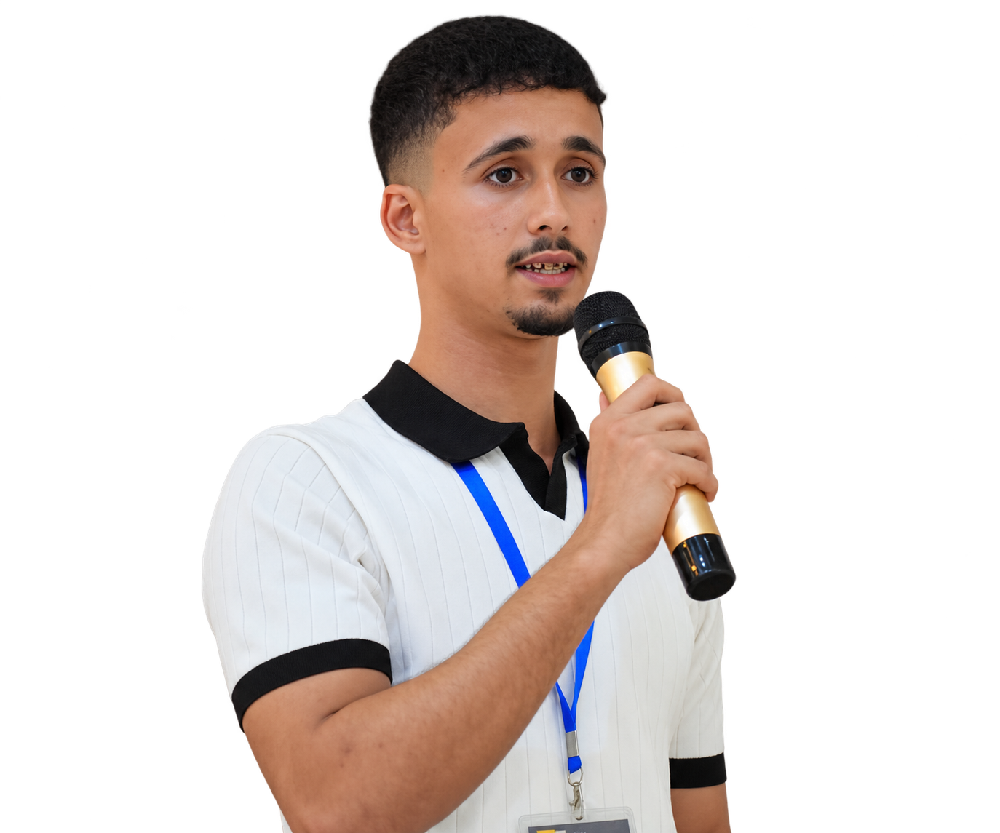

### Hi, I'm Ayoub.

I'm a full-stack developer based in **Morocco**. I build Python-backed products: SaaS platforms, business applications, and tools that turn complex workflows into something people can use.

My work connects **interfaces, APIs, databases, payments, and AI**. I care about the details between them—clear user flows, dependable data, and software that holds up after launch.

Currently building **[NovaQuill](https://novaquill.org/)** and available for selected freelance projects.

**[Work with me ↗](https://www.fiverr.com/ayoub_zarkouni)** &nbsp; · &nbsp; [LinkedIn](https://www.linkedin.com/in/ayoub-zarkouni-2207373b7) &nbsp; · &nbsp; [Email](mailto:ayoubzarkouni30@gmail.com)

 

## Selected work

### NovaQuill
**From a niche to an export-ready ebook.** &nbsp; SAAS · PRIVATE SOURCE

<a href="https://novaquill.org/">
  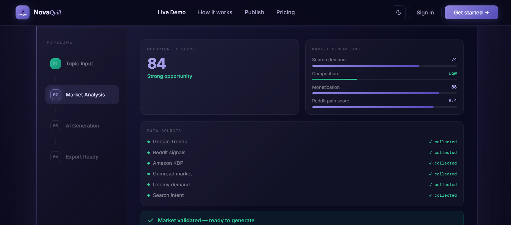
</a>
Public product demo · illustrative analysis data

A publishing workflow that brings topic analysis, structured generation, quality review, and PDF, DOCX, and EPUB exports into one product. Authentication, Stripe subscriptions, and plan-aware generation support the SaaS around it.

**Built with** Python · FastAPI · PostgreSQL · SQLAlchemy · Stripe · Groq

**[Explore NovaQuill ↗](https://novaquill.org/)**

---

### SiteGuard AI
**Website findings you can trace back to evidence.** &nbsp; PUBLIC REPOSITORY

<a href="https://github.com/AyOuBzArO/siteguard-ai">
  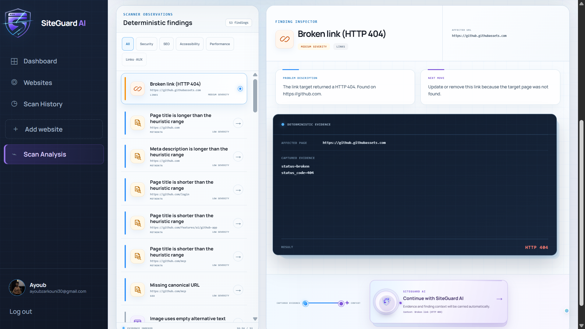
</a>
Finding Inspector · screenshot from the project repository

A website audit workspace for SEO, accessibility, security, and performance checks. Deterministic scanners produce findings and scores; the AI assistant explains selected findings and suggests remediation. Includes scan history and PDF reports.

**Built with** Python · Flask · MySQL · JavaScript · PageSpeed Insights · Groq · pytest

**[Explore the code ↗](https://github.com/AyOuBzArO/siteguard-ai)** &nbsp; · &nbsp; [See the architecture ↓](#inside-siteguard)

---

### Auto Rinta Car
**A bilingual storefront backed by a fleet-management system.** &nbsp; BUSINESS APPLICATION

<a href="https://autorintacar.com">
  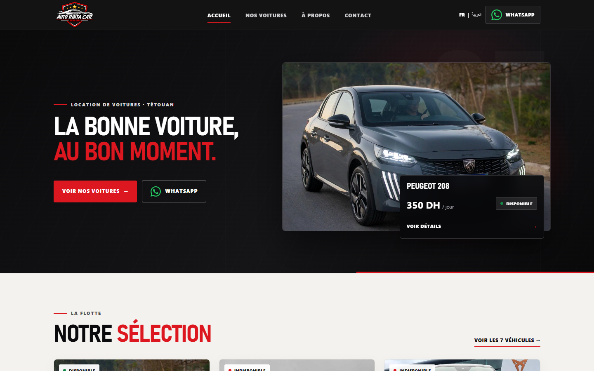
</a>
Public website · French and Arabic experience

Customers browse vehicles, pricing, availability, and galleries, then contact the agency through WhatsApp. Staff manage fleet details and photos in a protected administration area. The Arabic experience includes right-to-left layouts.

**Built with** Python · Flask · SQLAlchemy · SQLite · JavaScript

**[Visit Auto Rinta Car ↗](https://autorintacar.com)**

### Also built

- **[CSAI Days 2026](https://csaidays.medi-asd.org/hackathon.html)** — Frontend implementation for a technology event, with four languages, Arabic RTL support, and application flows. Deployment by collaborator Issam. [Code ↗](https://github.com/issama17/csaidays-2026)
- **[DevScope](https://github.com/AyOuBzArO/Developer-Portfolio-Analytics-Platform_Devscope)** — GitHub portfolio analysis with transparent heuristics and AI-assisted recommendations. Guidance, not a measure of developer quality.
- **[IMS](https://github.com/AyOuBzArO/Inventory-management-system)** — Inventory and sales management with interactive dashboards and a data-aware assistant.

## Inside SiteGuard

A design choice I'm proud of: **keep detection separate from AI guidance.**

<picture>
  <source media="(max-width: 600px)" srcset="assets/visuals/siteguard-flow-mobile.svg">
  
</picture>

The crawler is bounded. Findings retain their evidence. AI receives the selected finding as context, while scan results remain available independently of the AI provider.

Read the flow as text

1. Validate a public website URL and crawl within defined limits.
2. Run deterministic checks; use PageSpeed Insights for performance data.
3. Store evidence, findings, and category scores.
4. Present the analysis workspace and downloadable PDF report.
5. Optionally send a selected finding to Groq for explanation and remediation guidance.

## Toolkit

**Backend & data**

  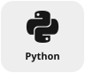
  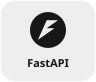
  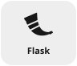
  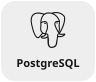
  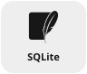

**Interfaces**

  
  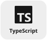
  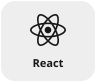
  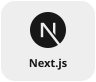
  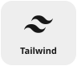

**Delivery & integrations**

  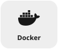
  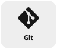
  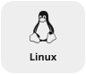
  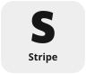

Also used across these projects: SQLAlchemy, MySQL, Prisma, Groq, OpenRouter, GitHub API, and pytest.

## Let's talk

Building a product, improving an existing application, or replacing a manual business workflow? Tell me what you're trying to solve.

**[Start a project on Fiverr ↗](https://www.fiverr.com/ayoub_zarkouni)** &nbsp; · &nbsp; [Connect on LinkedIn](https://www.linkedin.com/in/ayoub-zarkouni-2207373b7) &nbsp; · &nbsp; [Send an email](mailto:ayoubzarkouni30@gmail.com)

---

Ayoub Zarkouni · AyOuBzArO · Morocco
