  

  

  I design and build complete products—from interface and API architecture to data, deployment, and carefully bounded AI features.

  
  
  

## Selected work

<table>
  <tr>
    <td width="118" align="center"></td>
    <td>
      <h3>NovaQuill</h3>
      <strong>AI Ebook Generation SaaS</strong>
      
Transforms a niche into a researched, structured, and export-ready ebook with plan-aware generation, quality review, subscriptions, sharing, and multi-format publishing.

      <code>FastAPI</code> <code>PostgreSQL</code> <code>Stripe</code> <code>Groq</code>
    </td>
    <td width="130" align="center"></td>
  </tr>
</table>

<table>
  <tr>
    <td width="118" align="center"></td>
    <td>
      <h3>SiteGuard AI</h3>
      <strong>Website Quality &amp; Technical Audit Platform</strong>
      
Combines deterministic SEO, accessibility, security, TLS, broken-link, and performance checks with contextual remediation guidance.

      <code>Flask</code> <code>MySQL</code> <code>PageSpeed</code> <code>Groq</code>
    </td>
    <td width="130" align="center"></td>
  </tr>
</table>

<table>
  <tr>
    <td width="118" align="center"></td>
    <td>
      <h3>Auto Rinta Car</h3>
      <strong>Bilingual Car Rental Platform</strong>
      
Lets customers explore vehicles, pricing, availability, galleries, and direct WhatsApp contact flows while staff manage the fleet from a protected workspace.

      <code>Flask</code> <code>SQLAlchemy</code> <code>JavaScript</code> <code>RTL</code>
    </td>
    <td width="130" align="center"></td>
  </tr>
</table>

  
<strong>More projects — CSAI Days 2026, DevScope, and IMS</strong>

   
  <table>
    <tr>
      <td width="88" align="center"></td>
      <td><strong>CSAI Days 2026</strong> Responsive multilingual event experience with English, French, Spanish, and Arabic RTL support. <a href="https://csaidays.medi-asd.org/hackathon.html">Live site</a> · <a href="https://github.com/issama17/csaidays-2026">Repository</a></td>
    </tr>
    <tr>
      <td width="88" align="center"></td>
      <td><strong>DevScope</strong> GitHub portfolio analyzer using public repository data, transparent scoring, analytics, and AI-assisted recommendations. <a href="https://github.com/AyOuBzArO/Developer-Portfolio-Analytics-Platform_Devscope">Repository</a></td>
    </tr>
    <tr>
      <td width="88" align="center"></td>
      <td><strong>IMS</strong> Inventory and sales application with operational dashboards, interactive charts, and a data-aware assistant. <a href="https://github.com/AyOuBzArO/Inventory-management-system">Repository</a></td>
    </tr>
  </table>

## What I build

<table>
  <tr>
    <td width="50%"><strong>Product applications</strong> SaaS platforms · MVPs · developer tools · customer-facing products</td>
    <td width="50%"><strong>Business software</strong> Admin workspaces · inventory systems · operational dashboards · analytics</td>
  </tr>
  <tr>
    <td width="50%"><strong>Backend systems</strong> Python services · REST APIs · authentication · database workflows</td>
    <td width="50%"><strong>Connected experiences</strong> LLM features · payments · third-party APIs · multilingual interfaces</td>
  </tr>
</table>

## How I take a product from idea to release

  

> The animation follows the same principle as the work: movement with a purpose, a clear path, and a reliable result.

## Toolbox

  &nbsp;&nbsp;
  &nbsp;&nbsp;
  &nbsp;&nbsp;
  &nbsp;&nbsp;
  &nbsp;&nbsp;
  &nbsp;&nbsp;
  &nbsp;&nbsp;
  

  &nbsp;&nbsp;
  &nbsp;&nbsp;
  &nbsp;&nbsp;
  &nbsp;&nbsp;
  &nbsp;&nbsp;
  &nbsp;&nbsp;
  

<table>
  <tr><td><strong>Backend</strong></td><td>Python · FastAPI · Flask · REST APIs · SQLAlchemy</td></tr>
  <tr><td><strong>Frontend</strong></td><td>HTML · CSS · JavaScript · TypeScript · React · Next.js · Tailwind CSS</td></tr>
  <tr><td><strong>Data</strong></td><td>PostgreSQL · MySQL · SQLite · Prisma</td></tr>
  <tr><td><strong>AI &amp; integrations</strong></td><td>Groq · OpenRouter · GitHub API · Stripe · PageSpeed Insights</td></tr>
  <tr><td><strong>Engineering</strong></td><td>Git · GitHub · Docker · Linux · pytest</td></tr>
</table>

## Let's build something useful

Have an idea, an existing application, or a business workflow that should become reliable software? I'm available for selected freelance product-development work.

  
  
  

---

Designed and built by Ayoub Zarkouni · AyOuBzArO

